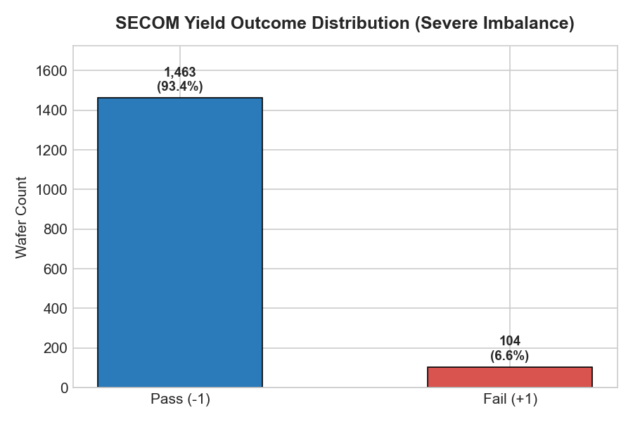
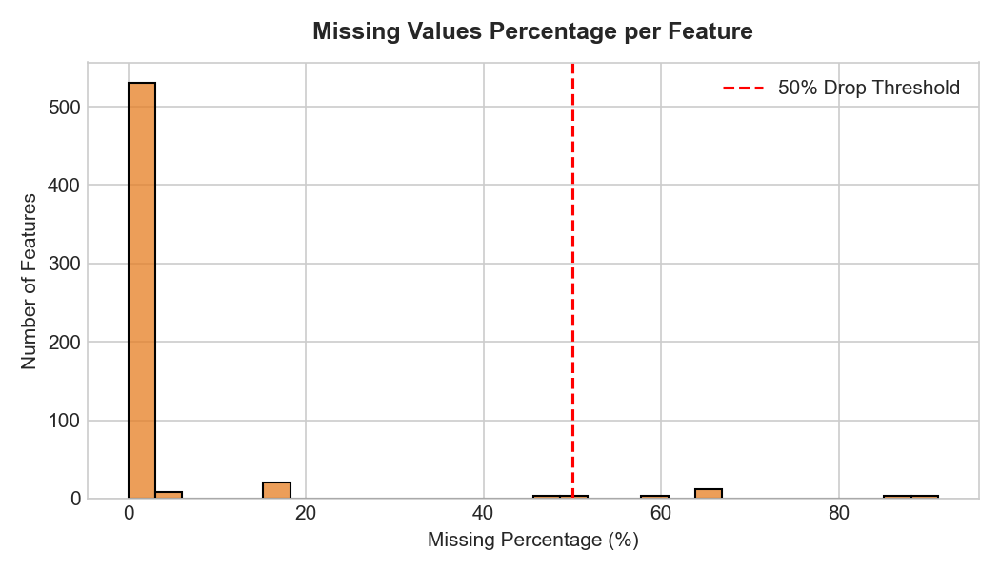
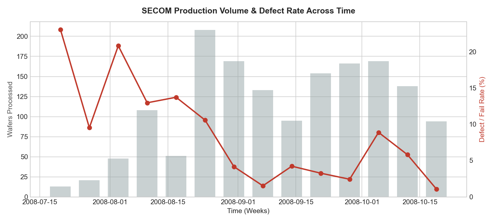
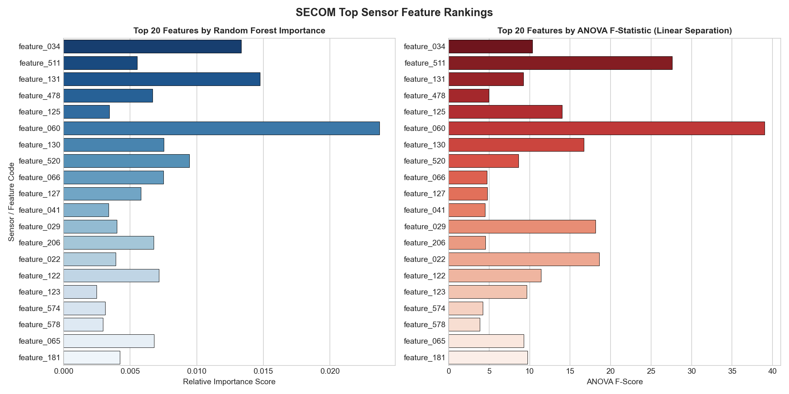

# SECOM Semiconductor Manufacturing Yield Analysis & Sensor Feature Ranking

[](https://www.python.org/)
[](LICENSE)
[](https://archive.ics.uci.edu/dataset/179/secom)
[](https://scikit-learn.org/)

An end-to-end exploratory data analysis (EDA), data cleaning, and multi-perspective feature selection pipeline for the **SECOM (Semiconductor Manufacturing)** dataset.

---

## 📌 Project Overview

In semiconductor wafer fabrication, modern production equipment is equipped with hundreds of continuous telemetry sensors monitoring process parameters (temperature, pressure, gas flow, RF power, etc.). However:
1. **Severe Imbalance**: Defective wafers occur rarely (~6.6% failure rate), making standard accuracy metrics misleading.
2. **High Dimensionality**: 590 sensor variables collected across only 1,567 wafer runs.
3. **Anonymized Sensors**: Feature identities and units are masked due to commercial IP protection.
4. **Noisy Telemetry**: Many signals represent dead sensors (zero variance) or contain heavy missing data.

This project delivers an automated pipeline to clean, diagnose, and rank the sensor signals that have the highest causal and statistical impact on yield failure.

---

## 📊 Key Dataset Metrics

| Metric | Value | Engineering Interpretation |
| :--- | :--- | :--- |
| **Total Wafers ($N$)** | 1,567 | Production runs spanning 89 operational days |
| **Pass Wafers (Normal)** | 1,463 (93.36%) | Majority class (coded as `-1` in raw files, `0` in pipeline) |
| **Fail Wafers (Defective)** | 104 (6.64%) | Minority target class (`+1` in raw files, `1` in pipeline) |
| **Class Imbalance** | **~14.1 : 1** | Requires balanced weighting / cost-sensitive metrics |
| **Raw Features** | 590 | Continuous analog and discrete process signals |
| **Zero-Variance Sensors** | 116 | Constant signals with zero variance (pruned) |
| **High Missingness (>50%)** | 28 | Inactive/sparse probes (pruned) |
| **Active Analyzed Features** | **446** | Cleaned and normalized signals for predictive ranking |

---

## 📈 Visual Insights

### 1. Severe Yield Imbalance


### 2. Missing Value Profiling


### 3. Production Timeline & Defect Excursions


### 4. Top 20 Ranked Sensor Features


---

## 🏆 Top Sensor Drivers of Yield Loss

By combining **Univariate ANOVA F-Scores**, **Mutual Information (Non-linear Dependency)**, and **Balanced Random Forest Gini Importance**, we established a **Consensus Borda Rank**:

| Rank | Feature | Pass Mean | Fail Mean | Excursion (% Shift) | ANOVA F-Score | RF Importance | Physical Interpretation |
| :---: | :--- | :---: | :---: | :---: | :---: | :---: | :--- |
| **1** | `feature_034` | 8.9313 | 9.3682 | **+4.89%** | 10.33 | 0.0133 | Steady positive elevation on defects |
| **2** | `feature_511` | 54.4406 | 74.3479 | **+36.57%** | 27.61 | 0.0055 | Substantial positive excursion on failure |
| **3** | `feature_131` | 0.7433 | 0.7687 | **+3.42%** | 9.24 | 0.0147 | High decision tree split utility |
| **4** | `feature_478` | 6.1051 | 8.3990 | **+37.57%** | 4.97 | 0.0067 | Pronounced shift during defect events |
| **5** | `feature_125` | 15.7918 | 15.8348 | **+0.27%** | 14.00 | 0.0034 | Strict tolerance parameter violation |
| **6** | **`feature_060`** | **2.5635** | **8.5151** | **+232.17%** | **39.04** | **0.0237** | **Major anomaly (>3x spike)** on defect |
| **7** | `feature_130` | -0.5880 | -0.0826 | **+85.94%** | 16.71 | 0.0075 | Significant upward drift from negative range |
| **8** | `feature_520` | 11.3933 | 15.4147 | **+35.30%** | 8.62 | 0.0094 | Strong positive shift |

> **Key Discovery**: `feature_060` exhibits a massive **+232% spike** in defective wafers, coupled with an ANOVA F-score of **39.04** and the highest tree importance score (**0.0237**). This signal represents a critical fault trigger in the fab line.

---

## 🛠️ Repository Structure

```
├── eda_analysis.py            # Automated Exploratory Data Analysis & quality audit
├── feature_ranking.py         # Multi-metric feature selection & consensus ranking
├── top_features_ranked.csv    # Output: all 446 features with scores and ranks
├── eda_summary_report.txt     # Output: summary report of data hygiene & statistics
├── requirements.txt           # Python library dependencies
├── .gitignore                 # Standard git ignore configuration
├── secom/                     # Dataset folder
│   ├── secom.csv              # 1567 x 590 feature matrix (CSV format)
│   ├── secom_labels.csv       # Pass/Fail yield labels and timestamps (CSV format)
│   ├── secom.data             # Original raw text space-delimited data
│   ├── secom_labels.data      # Original raw labels data
│   └── secom.names            # Original dataset documentation from UCI
└── plots/                     # Generated publication-quality figures
    ├── eda_class_distribution.png
    ├── eda_missingness_histogram.png
    ├── eda_timeline_defects.png
    └── top20_feature_importance.png
```

---

## 🚀 Getting Started

### 1. Installation

Clone the repository and install dependencies:

```bash
git clone https://github.com/engrfayyazabbas/secom-semiconductor-yield-analysis.git
cd secom-semiconductor-yield-analysis
pip install -r requirements.txt
```

### 2. Run Exploratory Data Analysis (EDA)

```bash
python eda_analysis.py
```
This inspects missing values, audits constant columns, calculates defect trends, and generates figures in `plots/`.

### 3. Run Multi-Perspective Feature Selection

```bash
python feature_ranking.py
```
This filters dead features, performs median imputation, executes ANOVA F-tests, Mutual Information, and Balanced Random Forests, and saves `top_features_ranked.csv`.

---

## 🔬 Working With Anonymous Industrial Datasets

When sensor labels are confidential, standard practice recommends:
1. **Prune Dead Signals**: Eliminate features with $Var(X) = 0$ (116 features in SECOM).
2. **Multi-Perspective Ranking**: Never rely on a single metric. Combining linear (ANOVA), information-theoretic (Mutual Information), and ensemble tree-based rankings prevents algorithm bias.
3. **Excursion Profiling**: Examine the relative percentage shift $(\mu_{\text{fail}} - \mu_{\text{pass}}) / |\mu_{\text{pass}}|$ to isolate catastrophic spikes vs tight-tolerance drifts.
4. **Proper Imbalance Metrics**: Optimize models for **Recall/Sensitivity**, **PR-AUC**, and **Balanced Error Rate (BER)** rather than raw accuracy.

---

## 📜 References & Acknowledgements

- **SECOM Dataset Donors**: Michael McCann and Adrian Johnston (2008).
- **UCI Machine Learning Repository**: [SECOM Dataset](https://archive.ics.uci.edu/dataset/179/secom)
