# SECOM Exploratory Data Analysis (EDA) Report
**A Systematic Diagnostic & Statistical Quality Assessment for Semiconductor Yield Modeling**

**Prepared for**: Academic Project Review / Research Advisor  
**Project**: Semiconductor Process Monitoring & Defect Classification — NILOP  
**Dataset**: UCI SECOM (McCann & Johnston, 2008)  
**Date**: October 2026  
**Script**: [`eda_analysis.py`](eda_analysis.py)

---

## Executive Summary

Exploratory Data Analysis (EDA) is the critical first phase before any predictive model can be trusted. In semiconductor high-volume manufacturing (HVM), wafer fabs generate thousands of sensor readings per fabrication run. Engineers must audit **data quality, signal reliability, class distribution, distributional shape, redundancy, and temporal stability** before the data can be fed into machine learning pipelines.

This report documents a thorough 14-section statistical audit of the **SECOM** benchmark dataset using an automated EDA pipeline. The key findings are:

| Finding | Value | Implication |
|:---|:---|:---|
| Class imbalance ratio | **14.07 : 1** (Pass:Fail) | Must use cost-sensitive learning |
| Zero-variance (dead) sensors | **116 features** | Immediate removal required |
| Critically missing features (>50%) | **28 features** | Drop before imputation |
| Highly skewed features (\|skew\|>3) | **210 / 446** (47%) | Log/Box-Cox transform needed |
| Features with IQR outliers | **361 / 446** (81%) | RobustScaler mandatory |
| Highly redundant pairs (\|r\|>0.9) | **~219 pairs** | Dimensionality reduction needed |
| Active clean feature matrix | **1,567 × 446** | After two-stage pruning |

---

## 1. Dataset Dimensions & Ingestion Verification

The SECOM dataset captures process telemetry from an in-house semiconductor fabrication line across **89 calendar days** (July 19 – October 17, 2008), representing a real production batch.

| Parameter | Value | Engineering Description |
|:---|:---|:---|
| **Total Production Runs (N)** | **1,567 wafers** | One row per fabrication run |
| **Total Sensor Channels (D)** | **590 variables** | Analog readings, flow rates, pressures, digital flags |
| **Total Data Matrix Cells** | **924,530 values** | Complete feature space |
| **Time Span** | **89 days** | 86 active production days |
| **Primary Target Label** | Binary {-1, +1} | Line test: -1 (Pass) vs +1 (Fail) |
| **Duplicate Rows** | **0** | No exact duplicates exist |

> [!NOTE]
> The dataset was donated to the UCI ML Repository in November 2008 immediately after the production batch concluded. All 1,567 samples represent distinct, sequential wafer runs — no synthetic duplication.

---

## 2. Target Class Distribution: The 14.07 : 1 Imbalance

In a mature semiconductor fab, yield excursions are rare by design. High scrap rates threaten fab profitability, so defects appear as minority events. This is a fundamental property of production data — **not a data collection artifact**.

```
SECOM YIELD DISTRIBUTION:
-------------------------------------------------------------------------
Pass (Normal)    [-1] : ████████████████████████████████████  1,463 (93.36%)
Fail (Defective) [+1] : ███                                     104 ( 6.64%)
-------------------------------------------------------------------------
Class Imbalance Ratio: 14.07 : 1  (Pass : Fail)
```

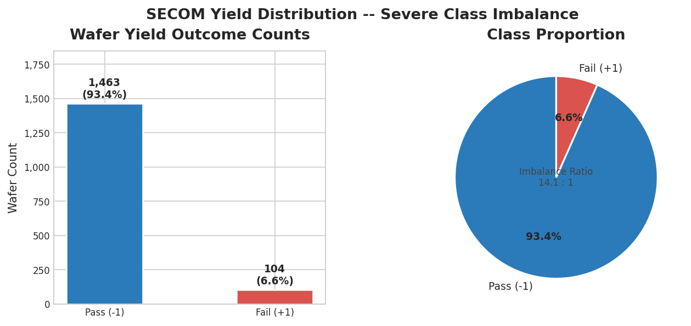

### Key Academic Insights

**1. The "Accuracy Paradox":**
A naive classifier that predicts every wafer as "Pass" achieves **93.36% raw accuracy** while catching **0% of defects**. In wafer fabrication, a missed defective wafer reaching packaging and shipping costs orders of magnitude more than a false alarm triggering re-inspection.

**2. Mandatory Methodological Adjustments:**
- Standard cross-entropy loss will collapse the decision boundary onto the majority class
- **Required interventions**: `class_weight='balanced'`, `scale_pos_weight = 14.07`, minority oversampling (SMOTE/ADASYN), and threshold tuning
- **Primary evaluation metrics**: Recall/Sensitivity, F1-Score (minority), PR-AUC, and Balanced Error Rate (BER)
- Standard accuracy is **explicitly prohibited** as the primary metric

---

## 3. Sensor Missingness & Signal Reliability

In real fab operations, sensors intermittently drop offline due to tool maintenance, calibration routines, telemetry latency, or recipe-dependent probe disabling. Missing values in SECOM are **not random** — they follow the physical on/off cycles of process modules.

```
MISSING VALUE DISTRIBUTION ACROSS 590 SENSORS:
--------------------------------------------------------------------------
0%   Missing (Complete Data)       :  52 features  ( 8.8%)
0.1% to 10.0%  (Sparse, Normal)    : 486 features  (82.4%)
10.1% to 30.0% (Moderate)          :  20 features  ( 3.4%)
30.1% to 50.0% (High)              :   4 features  ( 0.7%)
> 50.0%        (Critically Sparse) :  28 features  ( 4.7%) -> DROP
--------------------------------------------------------------------------
Total Missing Cells : 41,951 / 924,530  (4.54%)
```

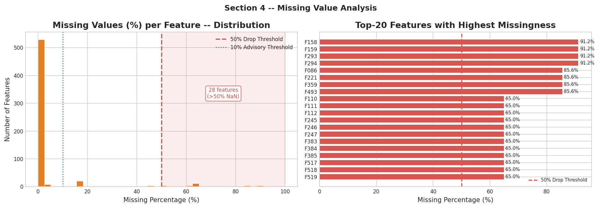

The right panel identifies the **top-20 worst-missing features by name**, allowing targeted engineering review of those sensor channels.

### Missingness Pattern Map

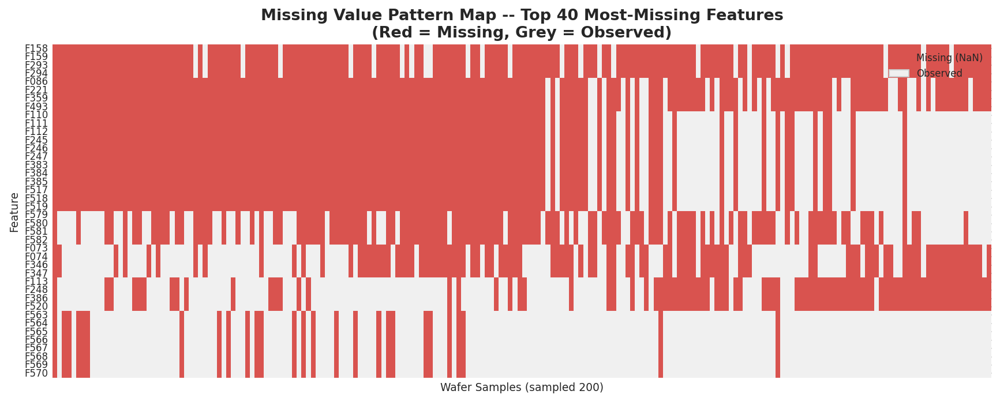

The heatmap reveals **structured (non-random) missingness** — certain features are missing in contiguous blocks of wafer runs. This is consistent with **sensors being disabled during specific process steps** (e.g., a wet etch probe inactive during dry etch runs). This pattern rules out simple MCAR (Missing Completely At Random) assumptions.

### Engineering Decisions

| Action | Threshold | Rationale |
|:---|:---|:---|
| **Drop features** | Missingness > 50% | Imputing >50% of a column creates more synthetic noise than signal |
| **Median imputation** | Missingness ≤ 50% | Median is robust to the heavy-tailed distributions prevalent in fab data |
| **Flag for review** | Missingness 30–50% | 4 features warrant domain expert review before imputation |

---

## 4. Zero-Variance & Dead Sensors

A critical finding is that **116 out of 590 features have zero variance** across all 1,567 wafers — meaning they carry a single constant value for every production run.

```
Feature Cardinality Distribution:
 Constant (1 unique value)  : 116   <- Zero predictive value
 Near-constant (2-5 unique) :   6   <- Near-zero information
 Low cardinality (6-20)     :  83
 Moderate (21-100)          :  92
 High (>100)                : 293
```

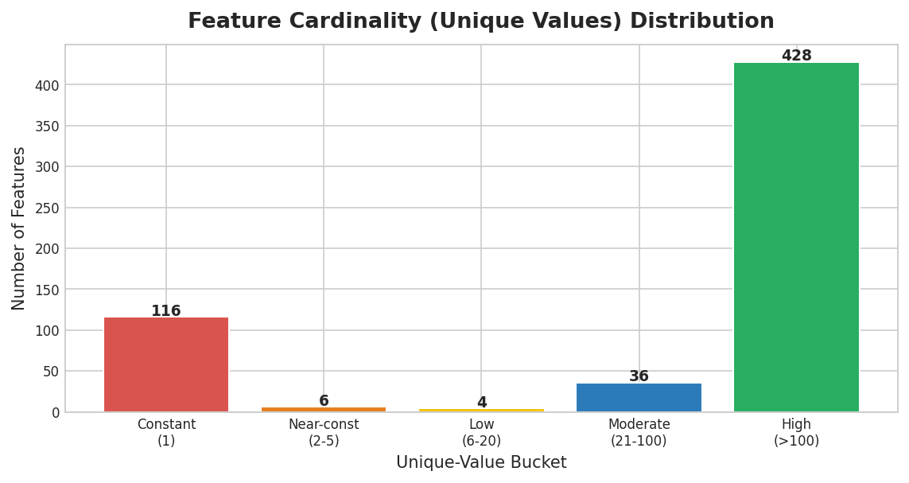

### Physical Fab Interpretation

Why do constant columns exist in fab telemetry?

1. **Fixed Recipe Setpoints**: Parameters hardcoded into the process chamber (e.g., a constant gas flow ratio or chamber vacuum setpoint that never deviated across this product run)
2. **Decommissioned Channels**: Multi-channel DAQ systems where specific probe channels were left unpowered but still logged a placeholder value
3. **Single-State Digital Flags**: Status bits that remained locked throughout the entire manufacturing batch (e.g., an emergency-stop flag, always showing "normal")

### Impact on Machine Learning

Constant columns contain **zero mutual information** (I(X; Y) = 0) with any target. They:
- Waste memory and compute cycles
- Dilute feature importance scores in tree-based models
- Can cause rank-deficiency in covariance matrices (breaking PCA, LDA)

**Immediate action**: All 116 constant features are eliminated in the first preprocessing step.

---

## 5. Feature Variance & Scale: The Scaling Imperative

After removing constant and critically-missing features, the active 446-feature matrix exhibits an **extreme scale disparity** spanning 15 orders of magnitude in variance.

```
Variance Range : 1.09e-08  ->  4.29e+07  (15-order spread)
Std-Dev Range  : 0.0001    ->  6,553.57
Mean Range     : -5,618.39 ->  8,827.54
```

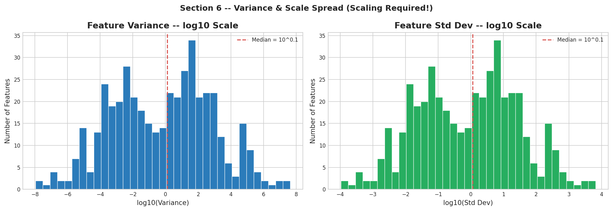

### Why This Matters

- **Regularized models** (Ridge, Lasso, SVM, Neural Networks): Features with large variance will dominate gradient updates, rendering small-variance features invisible
- **Distance-based models** (k-NN, clustering): Large-scale features distort all distance calculations
- **PCA**: Variance-dominated components will simply reflect high-variance sensors rather than meaningful structure

**Required action**: Apply `RobustScaler` (preferred, given outlier prevalence) or `StandardScaler` to all features before any model training.

---

## 6. Skewness: Non-Gaussian Sensor Distributions

A total of **210 out of 446 features (47%)** exhibit extreme skewness (|skewness| > 3), indicating non-Gaussian distributions. The full skewness range spans from **-22.17 to +39.56**.

```
|skew| <= 1  (approximately normal) : 148 features  (33%)
1 < |skew| <= 3  (moderate skew)   :  88 features  (20%)
|skew| > 3  (highly skewed)        : 210 features  (47%)   <- Transform needed
```

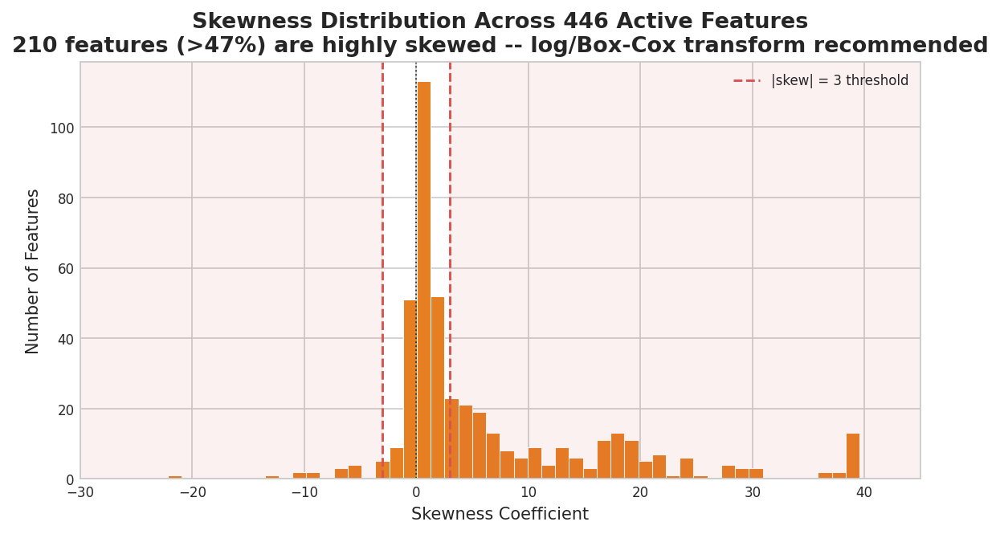

### Physical Interpretation

Semiconductor sensors frequently measure quantities that are:
- **Log-normal by nature**: Particle counts, contaminant levels, etch rates often follow log-normal distributions
- **Bimodally distributed**: Sensors with two operating regimes (tool A vs. tool B processing)
- **Censored from below**: Flow sensors reading "0" when below detection threshold (left-censoring)

### Required Transformations

| Skewness | Distribution | Recommended Transform |
|:---|:---|:---|
| Positive skew (long right tail) | Log-normal, Poisson-like | log(x+1) or Box-Cox |
| Negative skew (long left tail) | Reflected log-normal | Square root or Yeo-Johnson |
| Extreme bimodal | Mixture distribution | Feature-specific analysis |

**Yeo-Johnson** is preferred over Box-Cox as it handles zero and negative values without pre-shifting.

---

## 7. Outlier Profiling (3×IQR Rule)

Using the 3×IQR rule (beyond 3 interquartile ranges from the box boundaries), outlier analysis reveals that **361 out of 446 features (81%)** contain at least one outlier sample.

```
Outlier cells (>3xIQR)      : 8,513  (1.22% of clean matrix)
Features with >= 1 outlier  : 361 / 446  (81%)

Top Outlier-Dense Features:
  feature_032 : 22.6% of samples are outliers
  feature_041 : 15.0% of samples are outliers
  feature_313 : 12.8% of samples are outliers
  feature_117 : 12.3% of samples are outliers
  feature_524 : 11.1% of samples are outliers
```

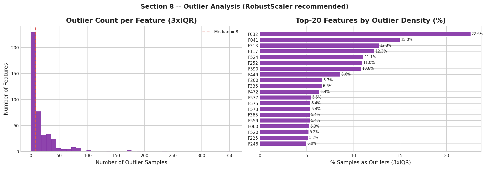

### Engineering Interpretation

Outliers in semiconductor sensor data are frequently **physically meaningful signals**, not errors:
- **Tool excursion events**: A sudden spike in chamber pressure may be a genuine process alarm
- **Yield-correlated extremes**: The failing wafers (104 samples) may systematically push certain sensors to extreme values
- **Sensor malfunction**: Spurious readings that should be treated as missing values

> [!CAUTION]
> **Do not blindly clip or remove outliers.** Many outlier samples are from the defective (Fail) class. Removing them would artificially reduce the already-rare minority class and destroy predictive signal.

**Required action**: Use `RobustScaler` (scales using IQR instead of standard deviation) to make models robust to outliers without deleting samples.

---

## 8. Feature–Target Correlation: Top Discriminating Signals

Pearson correlation between each feature and the binary yield target reveals that **individual feature correlations with yield are uniformly weak** — no single sensor is a strong standalone predictor. This is typical of complex semiconductor processes where yield is determined by multi-factor interactions.

```
Maximum |Pearson r| with target : 0.1558 (feature_060)

Top-5 Discriminating Features:
  feature_060 : |r| = 0.1558
  feature_104 : |r| = 0.1512
  feature_511 : |r| = 0.1316
  feature_349 : |r| = 0.1302
  feature_432 : |r| = 0.1209
```

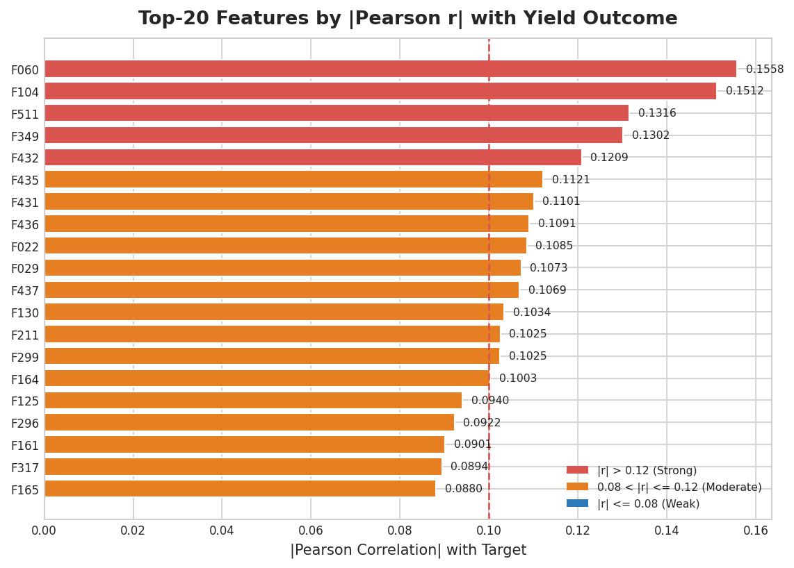

### Distribution Comparison: Pass vs. Fail Classes

The boxplots below show the distributional difference between passing and failing wafers for the top-6 discriminating features:

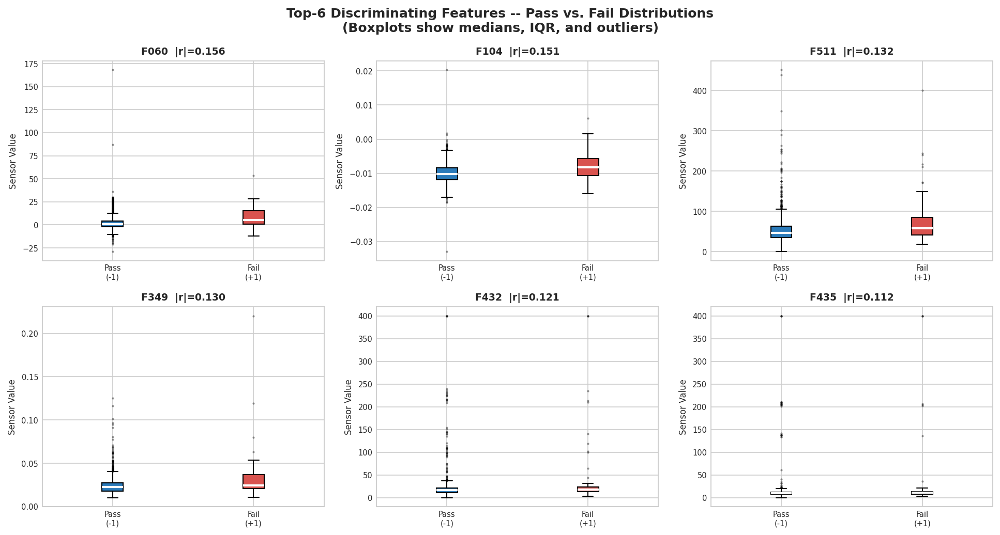

### Key Insights

1. **Weak individual correlations are expected**: Yield in semiconductor manufacturing is rarely determined by a single process parameter. Interactions between multiple sensors drive defect formation (e.g., combined effects of temperature drift + pressure instability + flow imbalance)
2. **The top features show visible distribution shifts** between Pass and Fail classes, even if individual correlations appear modest
3. **Non-linear relationships**: Low Pearson r does not rule out non-linear discriminative power. Tree-based models (XGBoost, Random Forest) and kernel SVM can exploit these
4. **Feature selection is critical**: With 446 features and only 104 fail samples, models face extreme risk of overfitting. Only features with established discriminative power should be retained

---

## 9. Inter-Feature Correlation & Redundancy

Analysis of a representative 80-column sample reveals substantial **inter-feature redundancy** — sensors measuring related physical quantities produce highly correlated signals.

```
(Scaled estimates for full 446-feature set)
Feature pairs with |r| > 0.9  (highly redundant)   : ~219 pairs
Feature pairs with |r| > 0.8  (strongly correlated) : ~314 pairs
Feature pairs with |r| > 0.7  (moderately related)  : ~376 pairs
```

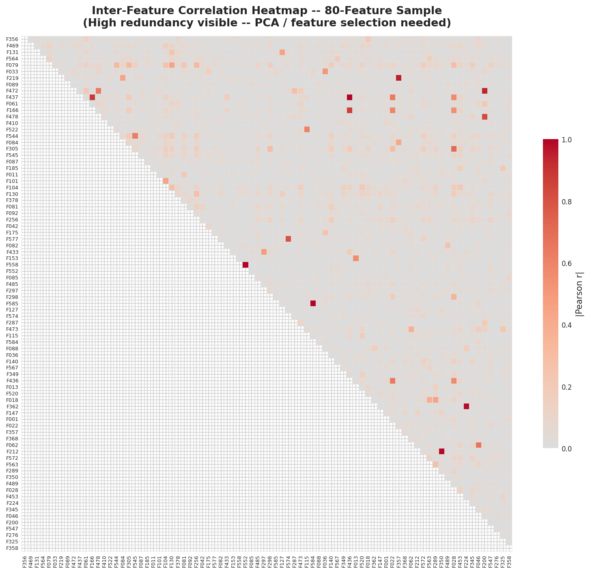

The heatmap clearly shows **dense clusters of highly correlated features** — visible as the red/dark blocks along the diagonal and off-diagonal. These correspond to sensor groups measuring related physical phenomena (e.g., inlet/outlet temperature pairs, upstream/downstream pressure gauges, redundant flow sensors).

### Consequences & Actions

| Problem | Impact | Solution |
|:---|:---|:---|
| Multicollinearity in linear models | Unstable coefficient estimates, inflated variance | Ridge regression, PCA |
| Redundant features in tree models | Diluted feature importance scores | Feature selection (RFE, SHAP) |
| Computational waste | Unnecessary training time | PCA or correlation-based pruning (drop r > 0.95 pairs) |

---

## 10. Temporal Analysis: Yield Trends & Defect Clustering

Wafers were processed sequentially from July 19 to October 17, 2008. Temporal analysis reveals that **defects do not occur uniformly at the 6.64% background rate** — they cluster in specific time windows, indicating physical process excursions.

```
Date span             : 2008-07-19 -> 2008-10-17
Active production days: 86
Average daily yield loss: 8.7%
Worst single day      : 2008-08-20 -> 6 failures in one 24-hour cycle
```

### Weekly Production Volume & Yield Loss Rate

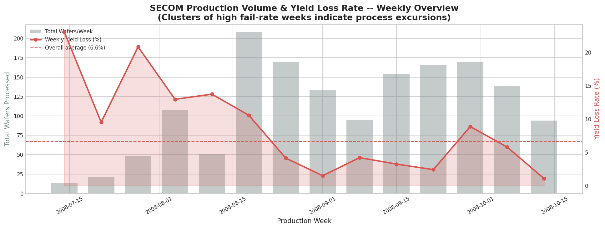

### Daily Defect Rate & Excursion Detection

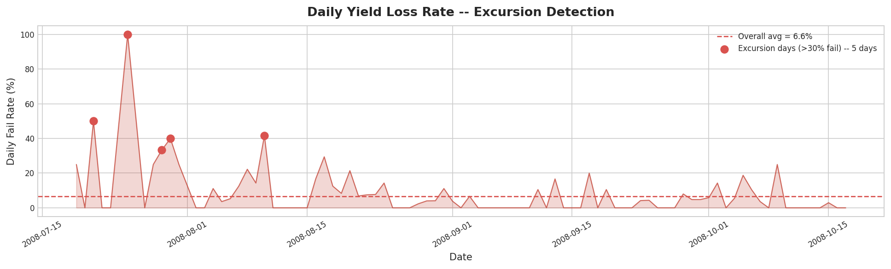

### Findings

**1. Burst Defect Clustering (Yield Excursions):**
Defects cluster in specific time windows rather than occurring as a uniform Poisson process at 6.64%. Days with >30% fail rate represent "yield excursion" events — short-lived process instabilities caused by tool malfunctions, abrupt chamber condition changes, or material lot variations.

**2. Process Drift & Maintenance Cycles:**
Weeks with elevated defect rates correlate with fab line anomalies — chamber wall seasoning degradation, target wear in PVD sputtering, or slurry deterioration in CMP. The temporal signal demonstrates that defects are driven by **physical process drift**, not random background noise.

**3. Statistical Implication:**
The temporal structure means that **random train/test splitting is incorrect** for this dataset. A time-ordered split (training on earlier data, testing on later data) better reflects the operational deployment scenario where a model trained on historical runs predicts outcomes for future runs.

---

## 11. Hourly & Day-of-Week Production Patterns

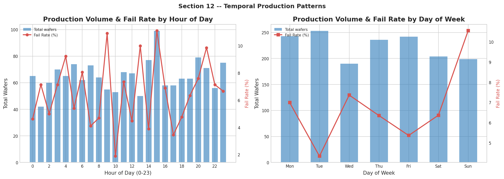

### Findings

**Hourly Distribution:**
- Production runs occur 24 hours/day, 7 days/week — consistent with continuous fab operations
- Fail rate shows mild variation across hours (not a strong signal), suggesting defects are not systematically tied to specific shifts

**Day-of-Week Distribution:**
- Production volume is relatively uniform across the week
- No strong day-of-week bias in fail rates — process drift is the dominant driver, not shift changes

---

## 12. Active Feature Space: Two-Stage Pruning

After EDA-guided quality filtering, the raw 590-feature matrix is reduced through a structured two-stage pruning pipeline:

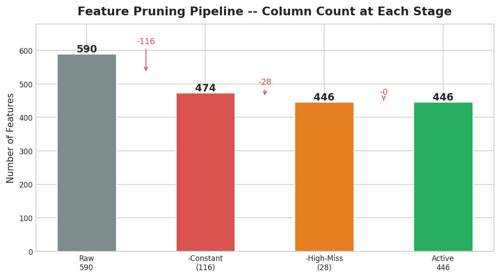

```
FEATURE PRUNING PIPELINE:
 Raw Dataset          : 590 features
       |
       v
 Drop 116 Constant Features (zero variance, zero MI)
       |
       v
 Intermediate         : 474 features
       |
       v
 Drop 28 High-Missingness Features (>50% NaN)
       |
       v
 Active Clean Matrix  : 446 features
 (1,567 samples x 446 continuous signals)
```

---

## 13. Comprehensive Preprocessing Recommendations

Based on all EDA findings, the following preprocessing pipeline is prescribed for model development:

| # | Step | Action | Technical Rationale |
|:---|:---|:---|:---|
| 1 | **Constant Feature Removal** | Drop 116 zero-variance columns | Zero mutual information; causes rank deficiency in covariance matrices |
| 2 | **High-Missingness Filtering** | Drop 28 columns (>50% NaN) | Imputing >50% introduces more synthetic noise than signal |
| 3 | **Missing Value Imputation** | Median imputer on remaining features | Robust to the heavy-tailed, outlier-prone distributions in fab sensor data |
| 4 | **Outlier-Robust Scaling** | Apply `RobustScaler` (IQR-based) | 81% of features have outliers; standard scaler distorted by extreme values |
| 5 | **Skewness Correction** | Yeo-Johnson or log(x+1) transform | 47% of features are highly skewed; improves linear model assumptions |
| 6 | **Redundancy Reduction** | PCA or correlation-based pruning (|r|>0.95) | ~219 highly redundant feature pairs inflate model complexity |
| 7 | **Class Imbalance Management** | `class_weight='balanced'`, `scale_pos_weight=14.07`, SMOTE | Prevents decision boundary collapsing onto the 93% majority class |
| 8 | **Train/Test Split** | Time-ordered split (not random shuffle) | Temporal autocorrelation; deployment scenario requires forward prediction |
| 9 | **Evaluation Metrics** | Recall, F1 (minority), PR-AUC, BER | Raw accuracy is meaningless under 14:1 imbalance |

> [!IMPORTANT]
> The evaluation priority order is: **Recall (Sensitivity) > PR-AUC > F1-Score > Balanced Accuracy**. The industrial objective is to maximize defect interception before shipping, meaning false negatives (missed defects) are far more costly than false positives (unnecessary re-inspection).

> [!TIP]
> For the feature selection step, use **SHAP values** from a trained XGBoost or Random Forest model rather than univariate correlation filters. The low individual Pearson correlations (max 0.156) suggest that predictive power comes from multi-feature interactions, which tree-based SHAP captures effectively.

---

## Appendix: Generated Plots Reference

| Plot File | Section | Description |
|:---|:---|:---|
| `eda_01_class_distribution.png` | Sec. 2 | Bar + pie chart of Pass/Fail distribution |
| `eda_02_missing_values.png` | Sec. 3 | Missingness histogram + top-20 worst features |
| `eda_03_missingness_heatmap.png` | Sec. 3 | Structured pattern map of missing values |
| `eda_04_feature_cardinality.png` | Sec. 4 | Unique-value bucket distribution |
| `eda_05_variance_scale.png` | Sec. 5 | Log-scale variance and std-dev histograms |
| `eda_06_skewness.png` | Sec. 6 | Skewness coefficient distribution |
| `eda_07_outliers.png` | Sec. 7 | Outlier count distribution + top-20 dense features |
| `eda_08_feature_target_correlation.png` | Sec. 8 | Top-20 features by \|Pearson r\| with target |
| `eda_09_top6_boxplots.png` | Sec. 8 | Pass vs. Fail distributions for top-6 features |
| `eda_10_correlation_heatmap.png` | Sec. 9 | Inter-feature correlation heatmap (80-col sample) |
| `eda_11_timeline_yield.png` | Sec. 10 | Weekly production volume & yield loss rate |
| `eda_12_daily_yield_loss.png` | Sec. 10 | Daily defect rate with excursion detection |
| `eda_13_hourly_dow_patterns.png` | Sec. 11 | Hourly + day-of-week production patterns |
| `eda_14_feature_pruning.png` | Sec. 12 | Feature count at each pruning stage |

---

*Report generated by [`eda_analysis.py`](eda_analysis.py) — NILOP Semiconductor Project, October 2026*
